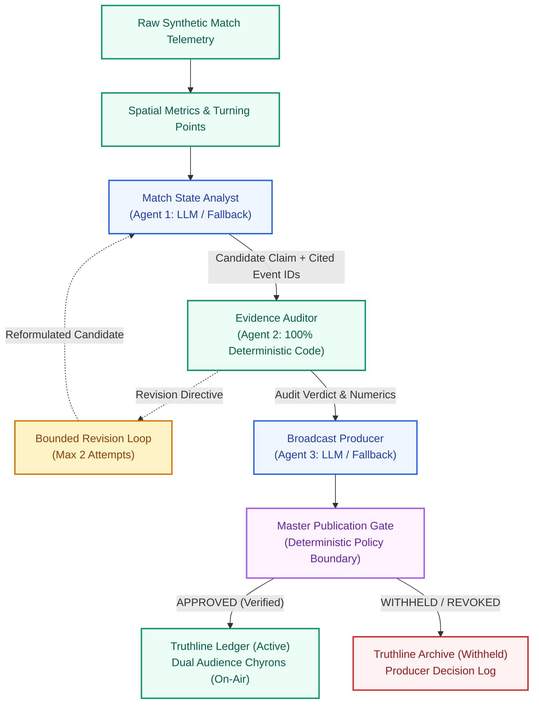
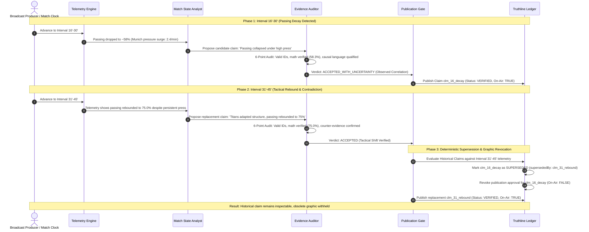
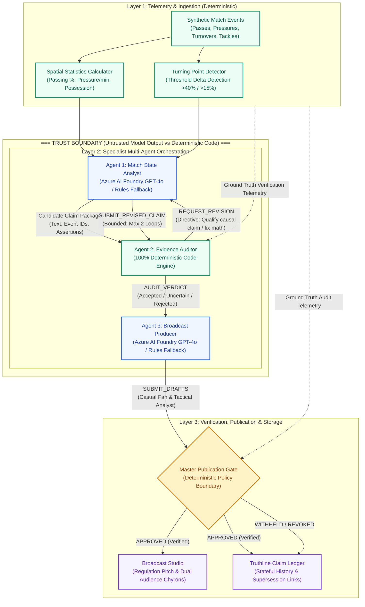
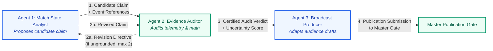
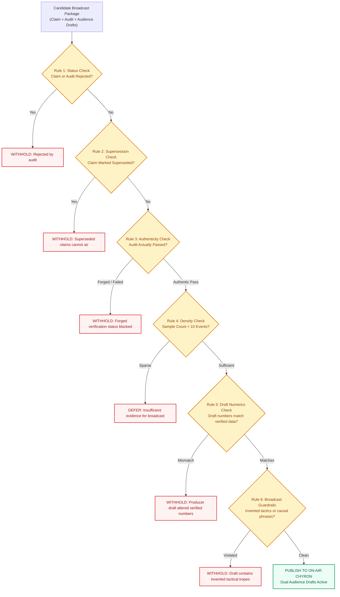
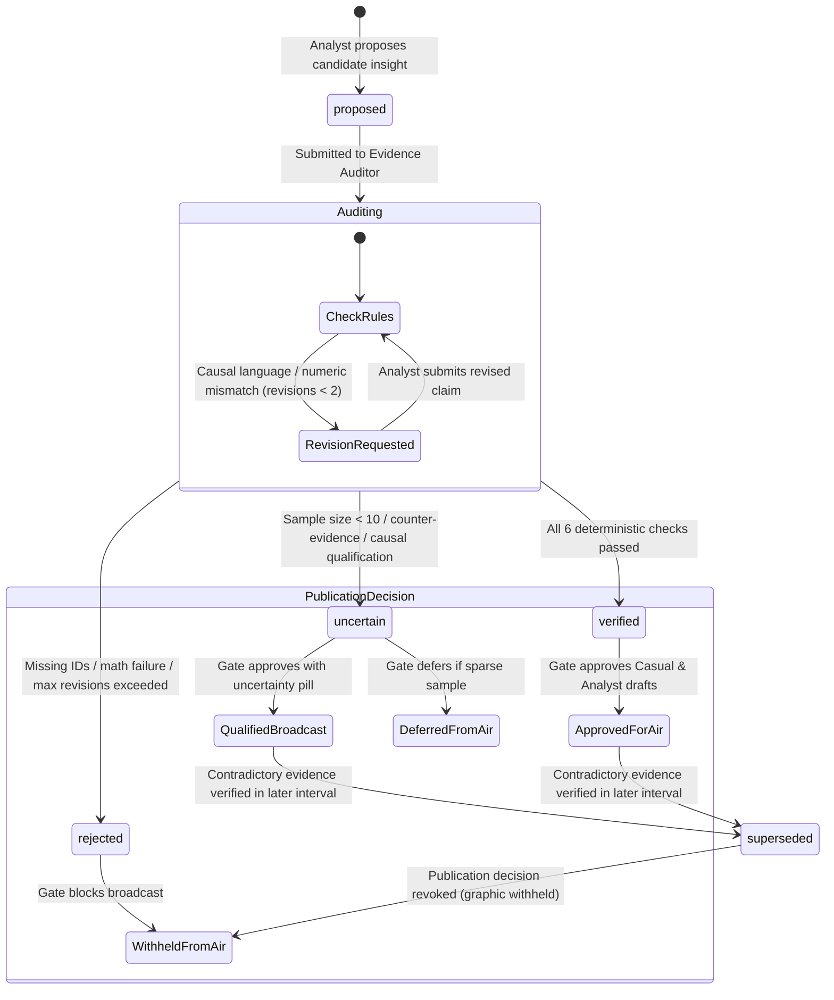
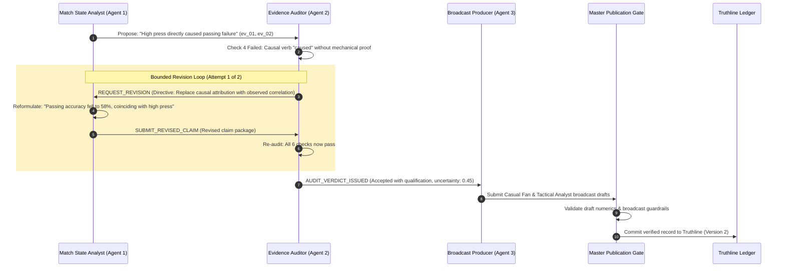
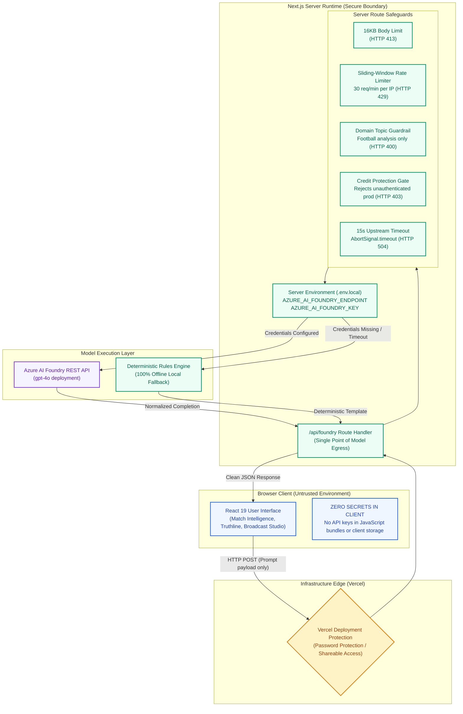
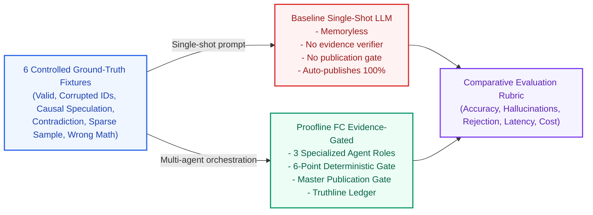

# Proofline FC

<div align="center">

### Every claim. Backed by evidence.

**Evidence-gated football intelligence that verifies AI-generated match insights against deterministic telemetry before broadcast.**

[](https://nextjs.org/)
[](https://react.dev/)
[](https://www.typescriptlang.org/)
[](package.json)
[](https://tailwindcss.com/)
[](https://ai.azure.com/)
[](src/lib/agents/microsoftAdapter.ts)
[-amber?style=flat-square)](#17-license-status)

[Interactive Judge Preview](https://proofline-fc-git-preview-demo-red-coder-27s-projects.vercel.app/) &nbsp;•&nbsp; [GitHub Repository](https://github.com/red-coder-27/proofline-fc) &nbsp;•&nbsp; [Architecture Deep Dive](docs/ARCHITECTURE.md) &nbsp;•&nbsp; [Benchmark Methodology](docs/EVALUATION.md) &nbsp;•&nbsp; [2-Minute Demo Script](docs/DEMO_SCRIPT.md)

</div>

---

> [!NOTE]
> **Solo Engineering Contribution**: Proofline FC was independently designed, architected, and implemented by a third-year Computer Science and Engineering student at Kumaraguru College of Technology (KCT) as an inquiry into trustworthy AI, multi-agent systems, and sports broadcast telemetry. It represents an independent engineering submission and is not officially affiliated with or endorsed by the Premier League, Microsoft, Azure, or any professional football club.

---

## Table of Contents

1. [Executive Summary & Core Principle](#1-executive-summary--core-principle)
2. [The Signature Demonstration: Claim Supersession](#2-the-signature-demonstration-claim-supersession)
3. [The Core Problem & Failure Modes](#3-the-core-problem--failure-modes)
4. [System Architecture & The Trust Boundary](#4-system-architecture--the-trust-boundary)
5. [Multi-Agent Roles & Responsibilities](#5-multi-agent-roles--responsibilities)
6. [The 6-Point Deterministic Evidence Gate](#6-the-6-point-deterministic-evidence-gate)
7. [The Master Broadcast Publication Gate](#7-the-master-broadcast-publication-gate)
8. [Truthline Ledger & Claim Provenance](#8-truthline-ledger--claim-provenance)
9. [End-to-End Orchestration & Bounded Revision](#9-end-to-end-orchestration--bounded-revision)
10. [Deployment Architecture & Trust Boundaries](#10-deployment-architecture--trust-boundaries)
11. [Benchmark Evaluation & Methodology (N=6 Fixtures)](#11-benchmark-evaluation--methodology-n6-fixtures)
12. [Technology Stack](#12-technology-stack)
13. [Quick Start & Local Development](#13-quick-start--local-development)
14. [Environment Variables Reference](#14-environment-variables-reference)
15. [Two-Minute Judge Demonstration Walkthrough](#15-two-minute-judge-demonstration-walkthrough)
16. [Security, Threat Model & Known Limitations](#16-security-threat-model--known-limitations)
17. [License Status & Contributing](#17-license-status--contributing)
18. [Documentation Index](#18-documentation-index)

---

## 1. Executive Summary & Core Principle

Modern football broadcasting increasingly turns to generative AI to produce interval summaries, tactical commentary, and on-air graphics. However, standard language models exhibit dangerous failure modes when applied to sports telemetry: they confuse correlation with causation, invent phantom event references, fabricate percentages, cling to stale narratives after tactical shifts, and hallucinate during sparse data intervals.

In a live broadcast with millions of viewers, an ungrounded or contradictory lower-third graphic destroys editorial trust.

Proofline FC solves this with a strict architectural principle:

$$\text{\textbf{AI may propose an insight. Evidence determines whether that insight may be broadcast.}}$$

Rather than expecting a generative model to self-verify, Proofline FC decouples discovery, auditing, and publication into three specialized agent roles backed by an external **6-point mathematical evidence gate**, an immutable claim ledger (**Truthline**), and a centralized **broadcast publication policy gate**.



---

## 2. The Signature Demonstration: Claim Supersession

The central engineering capability of Proofline FC is **claim supersession under contradictory evidence**.

In football, tactical reality evolves across intervals. A narrative established in the 25th minute can become completely obsolete by the 40th minute. Conventional LLMs cling to their initial premise or overwrite history memorylessly. Proofline FC preserves the historical audit trail while explicitly revoking obsolete on-air graphics:



### What Happens in the Code:
1. **Initial Insight (16'–30')**: London Titans passing accuracy drops from 84% to 58.3% (9 completed of 16 attempts) under Munich Red Star's pressure (2.4 actions/min). The claim is audited, causal assertions are qualified, and the claim is published to broadcast graphics.
2. **Contradictory Telemetry (31'–45')**: Munich maintains high pressure, but London Titans adapt their passing structure, rebounding to 75.0% accuracy (12 completed of 16 attempts).
3. **Deterministic Re-Evaluation**: The orchestrator (`src/lib/agents/orchestrator.ts`) checks whether the incoming verified claim invalidates earlier interval premises.
4. **State Transition**: The earlier claim (`clm_16_decay`) is transitioned to `status: 'superseded'`.
5. **Publication Revocation**: The Centralized Publication Gate marks `broadcastDecision.published = false`, logs `revocationRationale`, and withholds the obsolete graphic.
6. **Replacement Verification**: The replacement recovery claim (`clm_31_rebound`) is evaluated independently through the full 6-point verification gate before it is eligible for on-air broadcast. Supersession does not automatically certify the replacement claim.

---

## 3. The Core Problem & Failure Modes

When generative models analyze raw sports data without deterministic guardrails, six distinct failure modes emerge. Proofline FC implements an explicit architectural response to each:

| Failure Mode | How Standard LLMs Fail | Proofline FC Implemented Response | Engineering Limitation |
| :--- | :--- | :--- | :--- |
| **1. Correlation vs. Causation** | Asserts that high pressure *directly caused* every turnover without mechanical evidence. | **Epistemic Qualification (`guardrails.ts`)**: Causal trigger verbs (`caused`, `forced`, `led to`) are flagged and downgraded to certified correlation with an uncertainty score (0.45). | Uses vocabulary heuristics; does not perform causal graph discovery. |
| **2. Ungrounded Event References** | Cites hallucinated event IDs (e.g., `ev_phantom_991`) to sound authoritative. | **Event Reference Verification (`rules.ts`)**: Every referenced ID is cross-checked against the immutable match event stream. Missing IDs trigger immediate rejection. | Relies on the integrity of the upstream event generator. |
| **3. Numeric Discrepancies** | Hallucinates plausible-sounding numbers (e.g. claiming a 45% drop when true drop was 23%). | **Deterministic Recalculation (`verifier.ts`)**: Metrics are recomputed directly from raw coordinates and timestamps within strict tolerances ($\pm 1.5\%$ for passing, $\pm 0.2$/min for pressure). | Fixed tolerance windows; does not model sensor noise. |
| **4. Stale Narrative Lock-in** | Repeats early match storylines throughout the match, ignoring contradictory late-match data. | **Truthline Supersession (`orchestrator.ts`)**: Stateful claim ledger detects contradictory evidence, marks old claims as `SUPERSEDED`, and revokes broadcast eligibility. | Supersession currently operates within single-match scope. |
| **5. Failure to Abstain on Sparse Data** | Draws sweeping tactical conclusions during low-density intervals (<10 events). | **Sample Size Gate (`verifier.ts`)**: Intervals with $<10$ recorded events are automatically flagged as `insufficient_evidence` and deferred from broadcast. | Static count threshold (10 events); not density-scaled by game pace. |
| **6. Producer Narrative Drift** | LLM paraphraser embellishes verified facts with ungrounded tactical claims in final graphics. | **Master Publication Gate (`publicationGate.ts`)**: Re-scans generated broadcast drafts for unverified numbers and invented tactical phrases before on-air display. | Scans for known hallucination patterns and exact numbers. |

---

## 4. System Architecture & The Trust Boundary

Proofline FC enforces an explicit **trust boundary** between natural language generation and deterministic verification. Model completions are treated strictly as **untrusted candidate proposals** until certified by code that never delegates decisions to an LLM.



---

## 5. Multi-Agent Roles & Responsibilities

Proofline FC assigns distinct, non-overlapping responsibilities to three agents. The Evidence Auditor is deliberately implemented in **100% deterministic TypeScript** to ensure mathematical guarantees cannot be bypassed by prompt injection or model hallucination.

| Agent Role | Implementation Type | Model Role | Primary Responsibilities | Failure Handling & Boundaries |
| :--- | :---: | :--- | :--- | :--- |
| **Match State Analyst** (`Agent 1`) | Hybrid (LLM + Fallback) | Drafts candidate claims via live Azure AI Foundry structured JSON; specifies cited event IDs and quantitative assertions. | Ingests interval snapshots and turning points; identifies tactical shifts; responds to revision directives from the Auditor. | If Foundry is unconfigured or unreachable: switches to deterministic rules fallback templates. Model cannot certify its own output. |
| **Evidence Auditor** (`Agent 2`) | **100% Deterministic Code** | **None** (Explicitly zero LLM reliance) | Executes the 6-point evidence checklist; recalculates metrics from raw event coordinates; classifies epistemic modality; scans for counter-evidence. | Never delegates audit decisions to an LLM. Enforces a hard revision cap ($\le 2$ loops); fails closed to `rejected` upon exhaustion. |
| **Broadcast Producer** (`Agent 3`) | Hybrid (LLM + Fallback) | Generates audience-specific drafts: **Casual Fan** (plain English, zero jargon) and **Tactical Analyst** (exact baselines, uncertainty notes). | Formulates on-air lower-third chyrons; respects publication gate decisions; logs publication rationale. | Model drafts are strictly checked by the Master Publication Gate. Any ungrounded numbers or invented phrases are blocked from broadcast. |



---

## 6. The 6-Point Deterministic Evidence Gate

Before any candidate claim can be accepted or forwarded to the broadcast producer, it must pass the mathematical verification engine (`src/lib/verificationEngine/verifier.ts` and `rules.ts`):

```
Rule 1: referencedEventsExist    ──► All referenced IDs exist in match event stream
Rule 2: intervalBoundariesValid  ──► Event timestamps fall strictly within interval window
Rule 3: numericClaimsVerified    ──► Recalculated from raw events within strict tolerance
Rule 4: causalGuardrailPassed    ──► Causal words flagged; downgraded to correlation
Rule 5: counterEvidenceAssessed  ──► Contradictory events detected and uncertainty calibrated
Rule 6: sampleSizeSufficient     ──► Interval contains at least 10 recorded events
```

### Detailed Validation Contract:

1. **Event Reference Verification (`referencedEventsExist`)**:
   - Every cited event ID (e.g. `ev_sig_0012`) must exist in the match stream.
   - IDs are deduplicated before validation to prevent artificial count inflation.
   - If any cited ID is missing or invalid, the claim is immediately **`rejected`** with `uncertaintyScore: 1.0`.

2. **Interval Boundary Alignment (`intervalBoundariesValid`)**:
   - Every cited event's timestamp (`minute`, `second`) must fall strictly within the requested interval window (e.g. `16'–30'`).
   - Cross-interval data contamination (e.g. citing a minute 12 event to prove a minute 28 claim) triggers immediate rejection.

3. **Independent Metric Recalculation & Tolerance (`numericClaimsVerified`)**:
   - Metric percentages are recalculated directly from underlying raw events via `calculateTeamIntervalMetrics`.
   - Recalculated values must match claimed values within strict, metric-appropriate tolerances:
     - `passingSuccessRate`: Default tolerance is $\pm 1.5\text{ percentage points}$.
     - `pressureFrequencyPerMin`: Default tolerance is $\pm 0.2\text{ actions/min}$.
     - Other count metrics: Default tolerance is $\pm 1.0$.
   - **Fail-Closed Principle**: Non-finite numbers (`NaN`, `Infinity`) or unsupported metric names immediately fail verification.

4. **Epistemic Classification & Causal Guardrails (`causalGuardrailPassed`)**:
   - Regex and vocabulary parser flags unproven causal attribution verbs (`caused`, `led to`, `forced`, `resulted in`).
   - If causal language is detected without mechanical proof, the claim is qualified as **`accepted_with_uncertainty`** (`uncertaintyScore: 0.45`) and certified as observed correlation (`coincided with`).

5. **Counter-Evidence Assessment (`counterEvidenceAssessed`)**:
   - Scans raw event telemetry for contradictory evidence (e.g. successful progressive passes during an alleged breakdown, or recovery events).
   - High-weight counter-evidence raises calibrated uncertainty to `0.50`.

6. **Sample Size Threshold (`sampleSizeSufficient`)**:
   - The interval must contain at least 10 recorded match events.
   - If event count $< 10$, the claim is marked **`insufficient_evidence`** with calibrated high uncertainty ($\ge 0.85$) and deferred from broadcast.

---

## 7. The Master Broadcast Publication Gate

Even if an agent produces a candidate insight, it cannot be broadcast without approval from the centralized **Master Publication Gate** (`src/lib/verificationEngine/publicationGate.ts`). This server-side policy boundary enforces six broadcast safety rules:



### Publication Gate Safeguards:
- **Anti-Forgery Protection**: A caller cannot bypass the gate by setting `status = 'verified'` in JSON. The gate independently verifies that `audit.ruleChecks` authentically confirms event existence, numeric validity, and positive event count.
- **Supersession Revocation**: Superseded claims are permanently barred from being published as currently valid facts.
- **Audience Draft Numeric Veracity**: Final Casual Fan and Analyst drafts are parsed via regex for numeric statements (`%`, `/min`). Any number not grounded in the verified metric assertions causes the draft to be blocked.
- **Invented Tactical Phrase Guardrail**: Scans drafts for unearned broadcast cliches that models invent (e.g. `bypassed pressing traps`, `in their own half`, `guaranteeing a loss`, `tactical mastery`, `panicked`).

---

## 8. Truthline Ledger & Claim Provenance

All claims are tracked in the **Truthline Ledger** (`src/types/claims.ts`), an immutable record of tactical assertions, verification audits, revision histories, and publication decisions.

### Verified Claim Statuses (`ClaimStatus`):

| Claim Status | Meaning | Entry Condition | Broadcast Consequence | Inspectable in History? |
| :--- | :--- | :--- | :--- | :---: |
| **`proposed`** | Initial candidate claim drafted by Match State Analyst. | Emitted by Analyst; awaiting verification. | Ineligible for broadcast. | Yes |
| **`verified`** | Passed all 6 deterministic audit checks and approved by publication gate. | All 6 checks pass; recalculation within tolerance. | **Approved for on-air broadcast** (Casual & Analyst drafts). | Yes |
| **`uncertain`** | Qualified as observed correlation, accompanied by counter-evidence or sparse data warning. | Causal language flagged, counter-evidence detected, or sample count $<10$. | Qualified broadcast with uncertainty note, or deferred if sparse. | Yes |
| **`rejected`** | Failed event reference checks, failed numeric tolerance, or exceeded revision limit. | Missing event IDs, math mismatch, or ungrounded after 2 revisions. | **Strictly blocked from broadcast** (0% unverified rule). | Yes |
| **`superseded`** | Previously verified claim invalidated by subsequent contradictory evidence. | Verified claim arrives in later interval contradicting earlier premise. | **Publication revoked**; graphic withheld from broadcast. | **Yes (Full audit trail preserved)** |

### Claim Lifecycle State Diagram:



---

## 9. End-to-End Orchestration & Bounded Revision

When the Evidence Auditor detects an ungrounded assertion or causal overstatement, it does not simply crash or accept the flaw. It triggers a **bounded revision loop** with specific directives:



**Revision Loop Guardrails**:
- **Hard Limit**: The revision loop is capped at a maximum of 2 attempts (`maxRevisionLimit: 2`).
- **Exhaustion Handling**: If a claim cannot be verified after 2 revisions, it is automatically marked **`rejected`** and withheld from broadcast. Infinite deliberation loops are architecturally impossible.

---

## 10. Deployment Architecture & Trust Boundaries

Proofline FC enforces three distinct security operating tiers to ensure that API credentials, server quotas, and broadcast integrity are protected across local, preview, and production environments:



### Three Deployment Security Tiers (Aligned with [SECURITY.md](SECURITY.md)):

1. **Tier 1: Local Development (`NODE_ENV === 'development'`)**:
   - Runs locally at `http://localhost:3000`.
   - Full access to local deterministic agents and optional live Azure AI Foundry credentials configured in `.env.local`.
   - In-memory rate limiting (30 req/min) and 16KB payload limits active.

2. **Tier 2: Restricted Preview / Hackathon Evaluation (Vercel Deployment Protection)**:
   - For evaluator access on preview platforms ([Judge Preview Deployment](https://proofline-fc-git-preview-demo-red-coder-27s-projects.vercel.app/)), the entire application is protected at the infrastructure edge via **Vercel Password Protection / Shareable Access**.
   - Within this authenticated edge boundary, `ENABLE_LIVE_FOUNDRY=true` can be enabled in Vercel preview settings.
   - **Crucially, no secrets are distributed to browser clients or passed in client headers**. Evaluators authenticate via Vercel's edge gate.
   - Direct server-to-server calls may optionally supply `Authorization: Bearer <key>` if `FOUNDRY_ACCESS_KEY` is configured.

3. **Tier 3: Public Production Deployment (`NODE_ENV === 'production'` or `VERCEL === '1'`)**:
   - To prevent public budget exhaustion and denial-of-wallet attacks, anonymous public model calls are rejected by default with HTTP 403 (`ENABLE_LIVE_FOUNDRY !== 'true'`).
   - The application functions with **100% fidelity in deterministic verification mode**: every scenario, evidence check, publication gate, and broadcast chyron operates without external network dependencies.
   - In-memory rate limiting is single-instance; enterprise multi-tenant deployments require distributed Redis caching and Azure API Management.

---

## 11. Benchmark Evaluation & Methodology (N=6 Fixtures)

The evaluation harness (`src/lib/benchmarks/benchmarkRunner.ts`) executes a controlled ground-truth benchmark contrasting a standard **Baseline Single-Shot LLM** against the **Multi-Agent Evidence-Gated System**.

> [!IMPORTANT]
> **Benchmark Scope Disclosure**: This evaluation tests deterministic gating mechanics across **six controlled synthetic fixtures ($N=6$)** designed to evaluate specific failure modes. It demonstrates architectural correctness and verification guarantees; it does not claim large-N statistical generalization over real match feeds. The baseline is an illustrative, memoryless single-shot LLM without a verification engine or stateful ledger.



### Scenario-by-Scenario Evaluation Results ($N=6$):

| Fixture ID | Scenario Name | Failure Mode Tested | Baseline Single-Shot Result | Proofline FC Evidence-Gated Result | Ground-Truth Expectation |
| :--- | :--- | :--- | :---: | :---: | :---: |
| **`gt_01`** | **Verified Passing Degradation** | Valid statistical shift with genuine event IDs and matching denominators. | Published (100%) | **Published (Verified)** | `accepted` / Publish |
| **`gt_02`** | **Hallucinated Event References** | Candidate cites non-existent event IDs (`ev_phantom_991`, `ev_phantom_992`). | Leaked to broadcast (Hallucination) | **Blocked & Withheld (Rejected)** | `rejected` / Withhold |
| **`gt_03`** | **Unqualified Causal Speculation** | Analyst asserts press *directly caused* every misplaced pass without proof. | Published ungrounded causal claim | **Qualified to Correlation (Uncertain)** | `accepted_with_uncertainty` / Publish with note |
| **`gt_04`** | **Contradiction Supersession** | Passing rebounds to 75%+ in 31'-45', contradicting earlier collapse thesis. | Ignored contradiction (Stale) | **Earlier Claim Superseded & Revoked** | `accepted` / Supersede old |
| **`gt_05`** | **Sparse Sample Size (<10 events)** | Interval contains only 5 total events; data is statistically insufficient. | Published sweeping claim | **Deferred from Broadcast (Sparse)** | `insufficient_evidence` / Defer |
| **`gt_06`** | **Fabricated Numeric Delta** | Claim asserts 45% drop when true recalculated delta was only 23%. | Published false numbers | **Blocked & Withheld (Rejected)** | `rejected` / Withhold |

### Summary Metric Comparison Table:

| Metric Key | Evaluation Metric | Baseline Single-Shot | Multi-Agent Evidence-Gated | Mathematical Denominator & Formula |
| :--- | :--- | :---: | :---: | :--- |
| `supportedClaimAccuracy` | **Supported Claim Accuracy** | 100.0% | **100.0%** | $\frac{\text{Supported claims correctly published}}{\text{Total supported ground-truth claims}} \times 100$ ($N_{sup}=3$) |
| `unsupportedClaimRejectionRate` | **Unsupported Claim Rejection Rate** | 0.0% | **100.0%** | $\frac{\text{Flawed/sparse claims correctly blocked}}{\text{Total flawed/sparse ground-truth claims}} \times 100$ ($N_{flaw}=3$) |
| `unsupportedClaimHallucinationRate` | **Broadcast Hallucination Rate** | 100.0% | **0.0%** | $\frac{\text{Flawed/sparse claims leaked to broadcast}}{\text{Total flawed/sparse ground-truth claims}} \times 100$ ($N_{flaw}=3$) |
| `contradictionHandlingAccuracy` | **Contradiction Supersession Accuracy** | 0.0% | **100.0%** | $\frac{\text{Contradictions where earlier claim was marked SUPERSEDED}}{\text{Total contradiction scenarios}} \times 100$ ($N_{contra}=1$) |
| `correctAbstentionRate` | **Correct Abstention Rate** | 0.0% | **100.0%** | $\frac{\text{Sparse intervals correctly deferred}}{\text{Total sparse scenarios}} \times 100$ ($N_{sparse}=1$) |
| `averageLatencyMs` | **Verification Gate Overhead** | **1.2 ms** | 3.8 ms | Local deterministic verification execution duration via `performance.now()` across all scenarios ($N=6$, +2.6 ms in local mode) |
| `estimatedCostPerInsightUSD` | **Estimated Cost Per Insight** | **$0.0007** | $0.0017$ | Total tokens across 3 agents calculated at reference Azure OpenAI rate ($0.000005/token) |

---

## 12. Technology Stack

Verified directly from repository configuration, dependencies, and source code:

| Layer / Concern | Technology | Version | Purpose in Proofline FC |
| :--- | :--- | :---: | :--- |
| **Framework** | [Next.js](https://nextjs.org/) | `16.4.2` | App Router, Turbopack dev/build engine, server-side route handlers. |
| **UI Library** | [React](https://react.dev/) | `19.3.0` | Component state management, reactive timeline rendering, SVG pitch visuals. |
| **Language** | [TypeScript](https://www.typescriptlang.org/) | `5.x` | Strict type safety, discriminated unions for claims/audits, zero `any` policy. |
| **Styling** | [Tailwind CSS](https://tailwindcss.com/) | `4.x` | Modern utility styling via `@tailwindcss/turbopack`. |
| **Iconography** | [lucide-react](https://lucide.dev/) | `^1.59.0` | Accessible UI icons for navigation, audit indicators, and status pills. |
| **Test Runner** | Node.js Test Runner | `node:test` | Built-in test runner executed via [tsx](https://github.com/privatenumber/tsx) `^4.23.15` (64 tests across 13 suites). |
| **Linter** | [ESLint](https://eslint.org/) | `^9.x` | Code quality enforcement with `eslint-config-next`. |
| **Model Integration** | [Azure AI Foundry](https://ai.azure.com/) | REST API `2024-08-01-preview` | Authenticated chat completions (`gpt-4o`) with structured JSON schema output. |
| **Hosting Platform** | [Vercel](https://vercel.com/) | Cloud Edge | Serverless route execution with Vercel Deployment Protection. |

---

## 13. Quick Start & Local Development

### Prerequisites
- **Node.js**: `v20.x` or `v22.x` (LTS recommended)
- **npm**: `v10.x` or higher
- **Git**: Installed and configured

### 1. Clone & Install

```bash
# Clone the repository
git clone https://github.com/red-coder-27/proofline-fc.git
cd proofline-fc

# Install dependencies
npm install
```

### 2. Configure Environment (Optional for Live Inference)

Proofline FC is designed to run **100% offline out-of-the-box** using its deterministic rules fallback engine. If you do not have Azure AI Foundry credentials, skip this step.

```bash
# Copy example environment configuration
cp .env.example .env.local
```

*In Windows PowerShell:*
```powershell
Copy-Item .env.example .env.local
```

If configuring live Azure AI Foundry, edit `.env.local` with your endpoint and key:
```env
AZURE_AI_FOUNDRY_ENDPOINT=https://your-foundry-resource.openai.azure.com
AZURE_AI_FOUNDRY_KEY=your_azure_foundry_api_key_here
AZURE_AI_FOUNDRY_DEPLOYMENT=gpt-4o
AZURE_OPENAI_API_VERSION=2024-08-01-preview
```

### 3. Verify Code Quality & Test Suite

Verify that all 64 automated tests, TypeScript strict compilation, and ESLint pass cleanly:

```bash
# Run TypeScript compilation check
npx tsc --noEmit

# Run ESLint check
npm run lint

# Run full automated test suite (64 tests across 13 suites)
npm test

# Verify production build compilation
npm run build
```

### 4. Start Local Development Server

```bash
npm run dev
```

Open **`http://localhost:3000`** in your browser. The application is immediately ready for evaluation.

---

## 14. Environment Variables Reference

Verified from `.env.example` and `src/app/api/foundry/route.ts`:

| Variable Name | Required? | Default Value | Server-Side Only? | Purpose & Safe Placeholder Example |
| :--- | :---: | :---: | :---: | :--- |
| `AZURE_AI_FOUNDRY_ENDPOINT` | Optional | `undefined` | **Yes** | Azure AI Foundry / Azure OpenAI endpoint URL.<br/>`https://mre-foundry.openai.azure.com` |
| `AZURE_AI_FOUNDRY_KEY` | Optional | `undefined` | **Yes** | Authentication API key for Azure AI Foundry deployment.<br/>`abcdef1234567890abcdef1234567890` (placeholder) |
| `AZURE_AI_FOUNDRY_DEPLOYMENT` | Optional | `gpt-4o` | **Yes** | Target model deployment name.<br/>`gpt-4o` |
| `AZURE_OPENAI_API_VERSION` | Optional | `2024-08-01-preview` | **Yes** | Azure OpenAI REST API protocol version.<br/>`2024-08-01-preview` |
| `ENABLE_LIVE_FOUNDRY` | Optional | `false` | **Yes** | Set to `true` in Vercel preview settings to enable live model calls within Vercel password protection.<br/>`false` |
| `FOUNDRY_ACCESS_KEY` | Optional | `undefined` | **Yes** | Optional server-to-server access key for automated test runners or curl requests.<br/>`your_server_access_key_here` |

*Critical Security Notice: All variables are server-side only. Never prefix with `NEXT_PUBLIC_` and never commit credentials to source control.*

---

## 15. Two-Minute Judge Demonstration Walkthrough

Follow this exact sequence to experience the full evidence-gating and claim supersession lifecycle in under two minutes (detailed script available in [docs/DEMO_SCRIPT.md](docs/DEMO_SCRIPT.md)):

```
[0:00] Reset Simulation  ──►  [0:15] Advance to 16'-30'  ──►  [0:45] Advance to 31'-45'  ──►  [1:10] Truthline Ledger  ──►  [1:35] Broadcast Studio
   Initial Tactical              Passing Decay Detected          Contradictory Rebound           Inspect Superseded              Inspect Dual Chyrons
   Baseline (01'-15')            6/6 Audit Passed (58.3%)        Passing Rebounded (75.0%)       Claim & Revocation              Casual vs Analyst
```

1. **Minute 0:00 – 0:25: Initial Baseline & Discovery**
   - Navigate to **Match Intelligence** in the left Navigation Rail.
   - Click **Reset** in the top header to ensure the simulation begins at `01'–15'`.
   - Click **Advance Interval** to advance to `16'–30'`.
   - Notice London Titans passing accuracy drop to ~58% under Munich Red Star's pressure surge (2.4/min).
   - In the **Contextual Evidence Drawer**, inspect the candidate insight and the **6/6 Checks Passed** audit card. Point out how causal language was qualified to certified correlation.

2. **Minute 0:25 – 0:50: Inject Contradiction & Rebound**
   - Click **Advance Interval** again to advance to `31'–45'`.
   - An amber pill appears in the top header: `Phase 3: Contradictory Evidence Active`.
   - Notice telemetry shows London Titans adapted their shape, rebounding to 75.0% passing accuracy under sustained press.

3. **Minute 0:50 – 1:15: Truthline Ledger & Supersession**
   - Click **Truthline Ledger** in the left Navigation Rail.
   - Observe that the earlier `16'–30'` claim is prominently marked **`SUPERSEDED`** with an explicit explanation and link to the new claim.
   - Point out that the historical record remains inspectable, but its publication approval is revoked.
   - The newer `31'–45'` recovery claim displays a green **`VERIFIED`** badge.

4. **Minute 1:15 – 1:40: Broadcast Studio & Audience Personalization**
   - Click **Broadcast Studio** in the left Navigation Rail.
   - Hover over pitch markers to view the stationary inspection tooltip (`pointer-events: none`) and collision-avoided ID pills. Click a marker to lock selection.
   - Scroll to the lower-third broadcast card. Toggle between **Casual Fan** mode (*"Titans respond! After early trouble with the press..."*) and **Tactical Analyst** mode (*"Tactical Adaptation: passing rebounded to 75.0%..."*).
   - Inspect the **Producer Publication Decision Log** confirming 0% unverified publication.

5. **Minute 1:40 – 2:00: Scenario Lab & Benchmark**
   - Click **Scenario Lab** to inspect the step-by-step agent message handoff trace (`Analyst → Auditor → Producer`).
   - Click **Evaluation Benchmark** to inspect the 6 controlled ground-truth fixtures and the 0.0% hallucination rate metric.

---

## 16. Security, Threat Model & Known Limitations

### Implemented Security Controls (Verified in [SECURITY.md](SECURITY.md)):
- **Server-Side Credential Isolation**: Azure AI Foundry keys exist only in `.env.local` and server memory. No keys are bundled into client JavaScript.
- **Request Size Limitation**: Enforces a strict 16KB payload limit on incoming POST requests (HTTP 413).
- **Rate Limiting**: Sliding-window rate limiter limits client IPs to 30 requests per minute (HTTP 429).
- **Domain Guardrail**: Incoming prompts are scanned for football tactical keywords (`interval`, `match`, `pass`, `pressure`, `tactical`, `analyst`, `proofline`) to prevent use as an open LLM proxy (HTTP 400).
- **Execution Timeouts**: Upstream requests enforce a 15-second abort timeout (`AbortSignal.timeout(15000)`) to prevent thread hangs (HTTP 504).
- **Structured Error Responses**: Upstream provider failures return clean JSON error payloads without exposing provider stack traces or internal endpoints.

### Transparent Engineering Limitations:
- **Synthetic Telemetry**: The current prototype ingests synthetic event sequences generated with deterministic seeds. It has not yet been connected to real-time binary feeds (e.g. Opta or StatsBomb).
- **Fixed Interval Windows**: Analysis operates over fixed 15-minute segments (`01'–15'`, `16'–30'`, `31'–45'`). Rolling or event-driven segmentation is future work.
- **Single-Match Scope**: Truthline supersession currently tracks claims within a single match; cross-match campaign history is not yet implemented.
- **Controlled Benchmark Size**: The benchmark evaluates 6 controlled failure-mode fixtures. It demonstrates verification mechanics, not large-N statistical generalization over thousands of professional matches.
- **Single-Instance Rate Limiting**: The in-memory sliding-window rate limiter runs per Node.js process; a distributed multi-instance deployment requires an external cache (e.g. Redis or Azure API Management).

---

## 17. License Status & Contributing

### License Status
**Licensing has not yet been finalized by the repository owner.**
The project is currently provided for evaluation, academic assessment, and hackathon judging purposes. An open-source license (such as MIT or Apache 2.0) will be added upon confirmation by the repository maintainer.

### Contributing
Please review [CONTRIBUTING.md](CONTRIBUTING.md) for branch naming conventions, coding standards, and pre-submission verification procedures. All pull requests must pass:
```bash
npx tsc --noEmit && npm run lint && npm test && npm run build
```

---

## 18. Documentation Index

For deeper technical documentation, please consult the dedicated guides in the repository:

| Document | Primary Audience | Key Topics Covered |
| :--- | :--- | :--- |
| **[System Architecture](docs/ARCHITECTURE.md)** | Architects & Engineers | Layered architecture, model vs deterministic boundaries, multi-agent sequence diagrams, 6-point checklist mechanics. |
| **[Benchmark Methodology](docs/EVALUATION.md)** | Evaluators & Data Scientists | Ground-truth fixture specifications, mathematical metric formulas, denominators, and trade-off analysis. |
| **[2-Minute Demonstration Script](docs/DEMO_SCRIPT.md)** | Judges & Reviewers | Timed step-by-step walkthrough script, exact UI button clicks, and narration talking points. |
| **[Visual Asset & Screenshot Guide](docs/screenshots/README.md)** | Reviewers & Presenters | Recommended viewports, capture procedures, and asset specifications for all 6 core screens. |
| **[Security Policy](SECURITY.md)** | Security Auditors & Evaluators | Responsible disclosure guidelines, server-side safeguards, threat model boundaries, and deployment tiers. |
| **[Contributor Guidelines](CONTRIBUTING.md)** | Open-Source Contributors | Development setup, branch guidelines, coding standards, and pre-PR quality checklists. |
