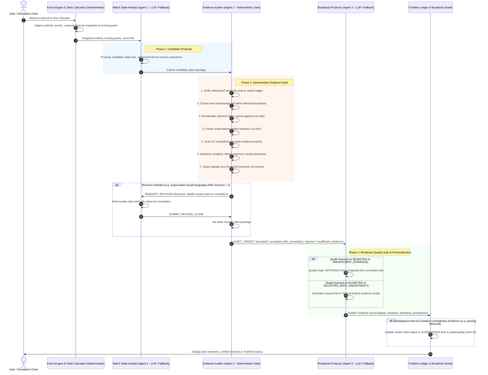
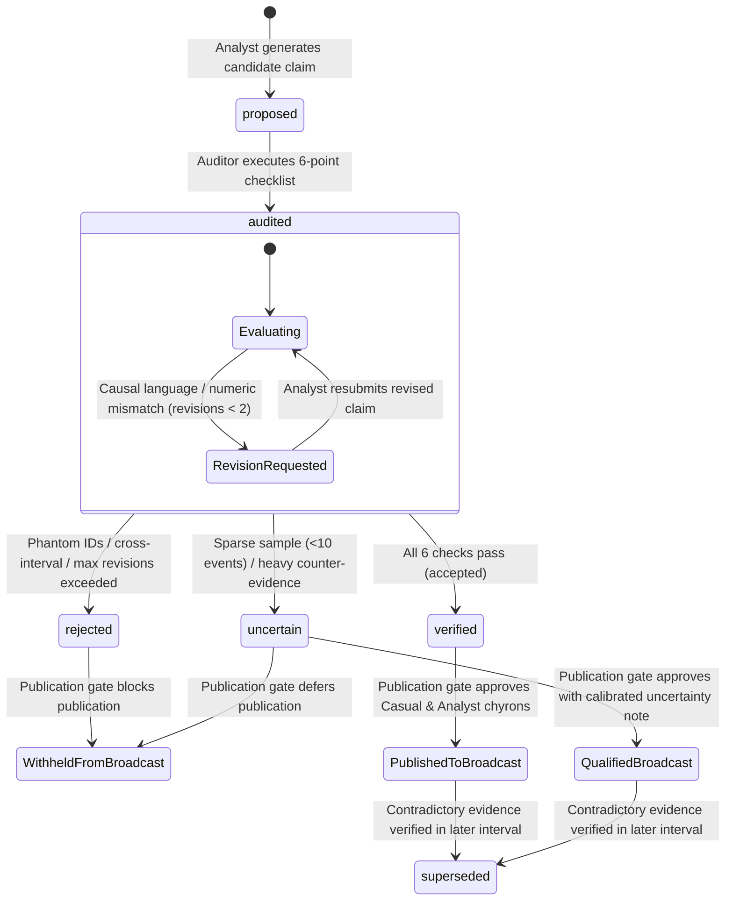

# Proofline FC

> **Every claim. Backed by evidence.**
>
> Evidence-gated football intelligence that verifies AI-generated match insights before broadcast.

---

## 1. Project Status & Verified Access

- **Development Status**: Active Prototype / Hackathon Evaluation Build
- **Runtime Environment**: Local Next.js 16 (Turbopack) application running at `http://localhost:3000`
- **Hosted Deployment**: Currently local-only; no public cloud deployment is active or verified.
- **Model Integration**: Microsoft Foundry / Azure OpenAI REST client with deterministic local rules fallback mode.
- **Verification Suite**: 57 automated unit, integration, regression, adversarial, and security tests passing across 13 test suites.

---

## 2. Problem Statement & Intended Users

### The Problem
Modern football broadcasting and tactical analysis increasingly rely on automated language models to generate post-match narratives, interval summaries, and live chyrons. However, standard LLMs suffer from severe failure modes when applied to sports telemetry:
1. **Correlation Masquerading as Causation**: Interpreting coincident events (e.g., fouls in midfield) as the direct cause of tactical breakdown without mechanical proof.
2. **Ungrounded Metric Hallucinations**: Citing phantom event identifiers or inventing percentage deltas that contradict underlying match telemetry.
3. **Narrative Inflexibility & Stale Tropes**: Clinging to an early match storyline (e.g., "Team A collapsed under high pressure") even after subsequent intervals provide direct contradictory evidence (e.g., passing accuracy rebounding to 80%+ under sustained press).
4. **Failure to Abstain**: Generating sweeping conclusions during low-density or sparse intervals (<10 events) where data is statistically insufficient.

### Intended Users
- **Broadcast Producers & Graphic Operators**: Delivering lower-third chyrons protected by deterministic verification and a centralized publication policy gate.
- **Tactical Analysts & Coaches**: Reviewing verified, provenance-backed event sequences with explicit uncertainty scores and counter-evidence scans.
- **Sports Media & Content Creators**: Serving both analytical audiences (exact metric baselines) and casual fans (clear English, zero unearned jargon) from a single factual core.

---

## 3. Solution Overview & Core Principle

Proofline FC solves this through an architectural principle:

> **"No insight may be presented as verified unless its supporting evidence passes deterministic validation."**

Rather than relying on an LLM to self-verify, Proofline FC decouples discovery, auditing, and publication into three specialized agent roles with an evidence ledger (**Truthline**), an external, deterministic 6-point verification engine, and a centralized publication gate.

```
Raw Synthetic Telemetry ──► Stats & Turning Points ──► [Match State Analyst]
                                                               │ (Candidate Claim)
                                                               ▼
[Publication Policy Gate] ◄── (Verdict / Audit) ◄── [Evidence Auditor]
           │                                                   │ (Directive)
           ▼                                                   ▼
Truthline Ledger & Broadcast Chyrons            [Bounded Revision Loop: Max 2]
```

---

## 4. Key Capabilities

1. **Deterministic Event Ingestion**: Ingests structured synthetic match events (passes, failed passes, pressures, turnovers, tackles) with precise timestamps, player/team attribution, and pitch coordinates.
2. **Spatial Metric & Turning Point Detection**: Computes interval snapshots (15-minute windows) and detects statistical threshold crossings (e.g., pressure surges >40%, passing decay >15%).
3. **Three Specialized Agent Roles**: Clear division of responsibility across Match State Analyst, Evidence Auditor, and Broadcast Producer.
4. **6-Point Deterministic Evidence Gate**: Independent mathematical verifier that checks event existence, interval boundaries, recalculates metrics against tolerances (±2.0%), and assesses sample size thresholds.
5. **Causal-Language Guardrails & Uncertainty Scoring**: Automatic epistemic qualification that catches causal language (`caused`, `directly led to`, `forced`) and downgrades claims to certified correlation (`coincided with`) with calibrated uncertainty scores.
6. **Truthline Ledger & Supersession Lifecycle**: Stateful claim tracking where subsequent contradictory evidence explicitly marks earlier claims as `SUPERSEDED`, recording the superseding claim ID and updating broadcast graphics.
7. **Centralized Broadcast Publication Gate**: Deterministic publication policy boundary. Unverified, out-of-interval, or rejected claims are withheld from on-air chyrons. Verified claims generate dual audience drafts: **Casual Fan** (plain English, no jargon) and **Tactical Analyst** (exact baselines, event provenance, uncertainty notes).
8. **Six Controlled Benchmark Fixtures**: Built-in evaluation harness contrasting single-shot LLM baseline generation against the multi-agent evidence-gated system across controlled ground-truth test items.s controlled ground-truth test items.

---

## 5. System Architecture

The following Mermaid sequence diagram illustrates the end-to-end data flow and boundaries between model inference and deterministic code:



---

## 6. Multi-Agent Roles & Responsibilities

| Agent Role | Model vs Deterministic | Primary Responsibilities | Handoff & Outputs |
| :--- | :--- | :--- | :--- |
| **Match State Analyst** (`Agent 1`) | LLM (Microsoft Foundry) with deterministic fallback | Analyzes interval telemetry and detected turning points; parses and validates model completion into candidate claim schema; specifies referenced event IDs and quantitative assertions; incorporates Auditor revision feedback. | Submits candidate claim package to `Evidence Auditor`. |
| **Evidence Auditor** (`Agent 2`) | **100% Deterministic Code** | Executes the 6-point evidence checklist; verifies event existence and interval boundaries; recalculates metrics from event telemetry; classifies epistemic modality; scans for counter-evidence; issues revision directives (max 2 loops) or rejections. | Emits audit verdict, rule check results, uncertainty score (0.0 to 1.0), and notes to `Broadcast Producer`. |
| **Broadcast Producer** (`Agent 3`) | LLM (Microsoft Foundry) with deterministic fallback | Enforces the Centralized Publication Gate (strictly blocks rejected/sparse/unverified claims); adapts verified insights into dual audience chyrons (Casual Fan vs Analyst); logs publication rationale. | Commits verified record to `Truthline Ledger` and updates `Broadcast Studio` display. |

---

## 7. Truthline Claim Lifecycle

Every claim tracked by Proofline FC moves through states defined strictly in `src/types/claims.ts`:



### Verified Claim Statuses in Code (`ClaimStatus`):
- `proposed`: Candidate claim drafted by Match State Analyst, awaiting audit.
- `verified`: Passed all 6 deterministic audit checks and approved by publication gate.
- `uncertain`: Qualified as observed correlation, accompanied by counter-evidence or sparse sample size warning.
- `rejected`: Failed event reference checks, failed numeric tolerance, or exceeded bounded revision loops.
- `superseded`: Previously verified or qualified claim superseded by a newly verified claim in a subsequent interval.

---

## 8. Technology Stack

Verified directly from repository configuration and source:

- **Framework**: [Next.js](https://nextjs.org/) `16.4.2` (Turbopack, App Router)
- **UI Library**: [React](https://react.dev/) `19.3.0`
- **Language**: [TypeScript](https://www.typescriptlang.org/) `5.x` (Strict mode)
- **Styling**: [Tailwind CSS](https://tailwindcss.com/) `4.x` with `@tailwindcss/turbopack`
- **Iconography**: [lucide-react](https://lucide.dev/) `^1.59.0`
- **Test Runner**: Node.js built-in test runner (`node:test`, `node:assert`) executed via [tsx](https://github.com/privatenumber/tsx) `^4.23.15`
- **Linter**: [ESLint](https://eslint.org/) `^9.x` with `eslint-config-next`

---

## 9. Microsoft Foundry Integration & Fallback Mode

Proofline FC supports direct integration with **Azure AI Foundry** (formerly Azure OpenAI Service) via an authenticated REST client.

### Configuration
Create a `.env.local` file in the project root (copied from `.env.example`):

```bash
# Azure AI Foundry / Azure OpenAI Endpoint URL
# Supported formats:
# 1. Base URL: https://<your-resource-name>.openai.azure.com
# 2. Azure AI Foundry Project URL: https://<your-project>.services.ai.azure.com
# 3. Model Inference URL: https://<your-resource>.services.ai.azure.com/models
AZURE_AI_FOUNDRY_ENDPOINT="https://your-foundry-resource.openai.azure.com"

# API Key for Azure AI Foundry / Azure OpenAI
AZURE_AI_FOUNDRY_KEY="your_api_key_here"

# Deployment / Model Name (default: gpt-4o)
AZURE_AI_FOUNDRY_DEPLOYMENT="gpt-4o"

# REST API Version (default: 2024-08-01-preview)
AZURE_OPENAI_API_VERSION="2024-08-01-preview"
```

### Server-Side Security Isolation
All model inference requests pass through the server-side Next.js route handler (`/api/foundry/route.ts`). API keys are never bundled into client JavaScript or exposed to browser network inspectors.

### Deterministic Rules Fallback Mode
When credentials are not configured, or if the cloud endpoint is unreachable (network timeout, HTTP 401/404):
1. The engine automatically switches to **Rules Fallback Mode** (`Microsoft Foundry Rules Engine (Deterministic Fallback)`).
2. The UI header prominently badges the active mode (`Rules Fallback (Active)`).
3. Candidate claim proposals, epistemic revisions, and audience drafts are generated using internal deterministic templates derived from the exact match statistics.
4. The full 6-point audit, Truthline ledger, and centralized publication gate operate identically in both live cloud and fallback modes.

---

## 10. Local Setup & Reproducibility

### Prerequisites
- **Node.js**: `v20.x` or `v22.x` (LTS recommended)
- **npm**: `v10.x` or higher
- **Git**: Installed and configured

### Installation & Run

1. **Clone Repository**:
   ```bash
   git clone https://github.com/red-coder-27/proofline-fc.git
   cd proofline-fc
   ```

2. **Install Dependencies**:
   ```bash
   npm install
   ```

3. **Configure Environment (Optional)**:
   ```bash
   cp .env.example .env.local
   # Edit .env.local if you wish to configure live Azure AI Foundry credentials.
   # If left unconfigured, the application runs in local Rules Fallback mode automatically.
   ```

4. **Verify Type Safety, Linting & Tests**:
   ```bash
   npx tsc --noEmit
   npm run lint
   npm test
   ```

5. **Start Development Server**:
   ```bash
   npm run dev
   ```
   Open **`http://localhost:3000`** in your browser.

6. **Production Build Verification**:
   ```bash
   npm run build
   npm run start
   ```

---

## 11. Environment Variable Reference

| Variable Name | Required? | Default Value | Purpose | Safe Example |
| :--- | :---: | :---: | :--- | :--- |
| `AZURE_AI_FOUNDRY_ENDPOINT` | Optional | `undefined` | Azure AI Foundry / Azure OpenAI base URL or inference endpoint. | `https://mre-foundry.openai.azure.com` |
| `AZURE_AI_FOUNDRY_KEY` | Optional | `undefined` | Authentication key for Azure AI Foundry model deployment. | `abcdef1234567890abcdef1234567890` (placeholder) |
| `AZURE_AI_FOUNDRY_DEPLOYMENT` | Optional | `gpt-4o` | Target deployment name for chat completions. | `gpt-4o` |
| `AZURE_OPENAI_API_VERSION` | Optional | `2024-08-01-preview` | Azure OpenAI REST API protocol version. | `2024-08-01-preview` |

*Note: All environment variables are server-side only. Do not prefix with `NEXT_PUBLIC_`.*

---

## 12. Available Scripts

Copied verbatim from `package.json`:

| Command | Action |
| :--- | :--- |
| `npm run dev` | Starts the Next.js development server with Turbopack at `http://localhost:3000`. |
| `npm run build` | Compiles the production application bundle and validates static page generation. |
| `npm run start` | Runs the compiled Next.js production build locally. |
| `npm run lint` | Executes ESLint across all TypeScript and React source files using Next.js core web vitals rules. |
| `npm run test` | Executes the 56-test automated suite using `tsx --test src/__tests__/**/*.test.ts`. |

---

## 13. Benchmark Evaluation Results

The evaluation harness (`src/lib/benchmarks/benchmarkRunner.ts`) runs 6 representative ground-truth test items through both a Baseline Single-Shot LLM agent and the Multi-Agent Evidence-Gated System.

### Verified Results Table (N=6 Ground-Truth Scenarios)

| Evaluation Metric | Baseline Single-Shot | Multi-Agent Evidence-Gated | Mathematical Denominator & Definition |
| :--- | :---: | :---: | :--- |
| **Supported-Claim Accuracy** | 100.0% | **100.0%** | Valid claims published / Total supported scenarios ($N_{sup}=3$) |
| **Unsupported-Claim Rejection Rate** | 0.0% | **100.0%** | Flawed/sparse claims blocked / Total flawed scenarios ($N_{flaw}=3$) |
| **Broadcast Hallucination Rate** | 100.0% | **0.0%** | Flawed/sparse claims leaked to broadcast / Total flawed scenarios ($N_{flaw}=3$) |
| **Contradiction Supersession Accuracy** | 0.0% | **100.0%** | Stale claims superseded / Total contradiction scenarios ($N_{contra}=1$) |
| **Correct Abstention Rate** | 0.0% | **100.0%** | Sparse intervals deferred / Total sparse scenarios ($N_{sparse}=1$) |
| **Mean End-to-End Latency** | **1.2 ms** | 3.8 ms | Wall-clock execution time via `performance.now()` across all 6 test scenarios (+2.6 ms in local mode) |
| **Estimated Cost Per Insight** | **$0.0007** | $0.0017 | Total tokens across pipeline calculated at reference $0.000005 per token |

### Benchmark Caveats & Scope Disclosure
- **Sample Size ($N=6$)**: This benchmark tests deterministic gating mechanics across six controlled failure modes. It demonstrates architectural correctness, not large-N statistical generalization over real match feeds.
- **Synthetic Data**: The events tested are synthetic event sequences generated by `generator.ts` with fixed seeds to guarantee reproducibility.
- **Latency & Cost**: Latency figures represent local test execution with deterministic verification. In live cloud mode, latency reflects actual network round-trip time to Azure AI Foundry endpoints. Token usage is reported from the provider when live, or marked "Not reported". Cost is an estimate based on published token reference rates.

---

## 14. Two-Minute Demonstration Walkthrough

Follow this sequence to evaluate the platform in under two minutes:

1. **Minute 0:00 - 0:30 (Initial Discovery & Audit)**:
   - Start in **Match Intelligence Workspace**.
   - Notice the initial tactical baseline for Interval `01'-15'`.
   - Click **"Advance Interval"** to `16'-30'`.
   - Observe London Titans passing accuracy drop to ~58% under Munich Red Star's high-press surge (2.4/min).
   - In the **Contextual Evidence Drawer**, inspect the verified event references and note how causal assertions were qualified.
2. **Minute 0:30 - 1:00 (Inject Contradiction & Supersession)**:
   - Click **"Advance Interval"** to `31'-45'`.
   - Notice London Titans passing rebounds to 75%+ despite sustained opponent pressure.
   - Switch to **Truthline Ledger**: observe the earlier "Passing Collapse" claim marked **SUPERSEDED** with a clear explanation and link to the new adaptation claim.
3. **Minute 1:00 - 1:30 (Broadcast Studio & Audience Chyrons)**:
   - Switch to **Broadcast Studio**.
   - Inspect the regulation tactical pitch visualization. Hover over event markers and collision-avoided cited evidence pills. Click a marker to lock selection.
   - Toggle between **Casual Fan** mode (*"Titans respond! After early trouble..."*) and **Tactical Analyst** mode (*"Tactical Adaptation: passing rebounded to 75.0%..."*).
   - Review the **Producer Publication Decision Log** confirming 0% unverified publication.
4. **Minute 1:30 - 2:00 (Scenario Lab & Evaluation Benchmark)**:
   - Switch to **Scenario Lab** to inspect the 6 controlled scenarios and observe the step-by-step agent message handoff trace.
   - Switch to **Evaluation Benchmark** to view the live comparison metrics and individual ground-truth test breakdown.

---

## 15. Recommended Screenshots & Asset Guide

Because raster images are not committed to source control, capture and save the following screenshots into a `docs/screenshots/` directory if preparing presentation slides or submission materials:

1. `docs/screenshots/01-workspace-overview.png`: Full-screen Match Intelligence Workspace showing pitch markers, momentum trend chart, and turning points drawer.
2. `docs/screenshots/02-truthline-supersession.png`: Truthline Ledger displaying a claim marked `SUPERSEDED` linked to its superseding revision.
3. `docs/screenshots/03-broadcast-studio-pitch.png`: Broadcast Studio frame with hover inspection card, cited evidence pills, and leader lines.
4. `docs/screenshots/04-audience-chyrons.png`: Side-by-side view of Casual Fan versus Tactical Analyst on-air chyron drafts.
5. `docs/screenshots/05-scenario-lab-trace.png`: Scenario Lab step-by-step agent message trace showing Analyst → Auditor → Producer handoffs.
6. `docs/screenshots/06-benchmark-comparison.png`: Evaluation Benchmark dashboard showing 0% hallucination rate and latency comparison.

---

## 16. Known Limitations & Threat Model Boundaries

- **Synthetic Telemetry**: Match events are synthetically generated for deterministic evaluation. The system has not yet been connected to real-time Opta/StatsBomb binary feeds.
- **Fixed Interval Windows**: The current engine evaluates fixed 15-minute windows (`01'-15'`, `16'-30'`, `31'-45'`). Dynamic rolling-window segmentation is planned for future work.
- **Bounded Revision Horizon**: The revision loop is intentionally capped at 2 attempts to prevent infinite agent deliberation loops. If a claim cannot be verified in 2 revisions, it is rejected.
- **Single-Match Scope**: Historical supersession currently operates across intervals within a single match; cross-match campaign history is not yet implemented.

---

## 17. Security & Contribution Guidelines

- **Security Policy**: Please review [SECURITY.md](./SECURITY.md) for vulnerability disclosure procedures. Never commit credentials or API keys.
- **Contributing**: Please review [CONTRIBUTING.md](./CONTRIBUTING.md) for branch naming, coding standards, and test verification requirements.

---

## 18. License Status

**Licensing has not yet been finalized by the repository owner.**
The project is currently provided for evaluation and review purposes. An open-source license (such as MIT or Apache 2.0) will be added upon confirmation by the repository maintainer.

Preview deployment verification
