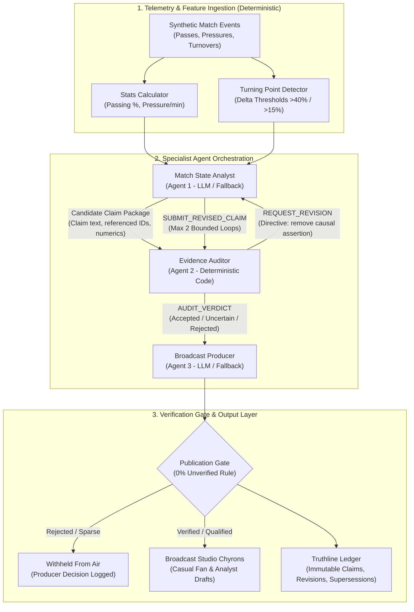
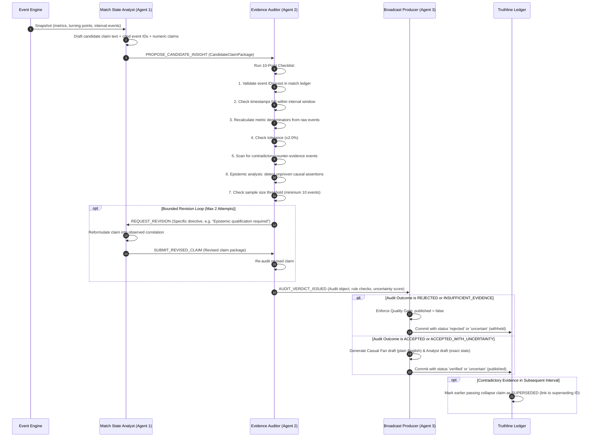
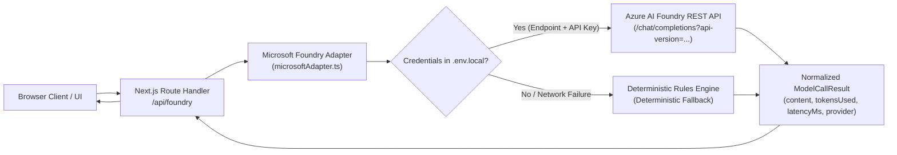

# Proofline FC — System Architecture & Verification Mechanics

## Executive Summary

Proofline FC is an evidence-gated multi-agent platform designed to produce factual, explainable tactical insights from football telemetry. Its central architectural guarantee is that **no language model output may bypass deterministic verification**.

---

## 1. Core Architecture & Component Boundaries

The platform is organized into three distinct layers:
1. **Telemetry & Feature Ingestion Layer**: Ingests raw match events, computes rolling spatial statistics, and detects statistical threshold crossings (turning points).
2. **Specialist Multi-Agent Orchestration Layer**: Coordinates proposal, audit, bounded revision, and broadcast packaging.
3. **Evidence Verification & Ledger Layer**: Runs deterministic 10-point mathematical verification, maintains the Truthline ledger, and gates on-air broadcast displays.



---

## 2. Model vs. Deterministic Boundaries

To guarantee technical credibility, model-based reasoning is strictly bounded:

| Component | Execution Type | Model Role | Deterministic Fallback / Gate |
| :--- | :---: | :--- | :--- |
| **Event Generator** | Deterministic | None | Pseudorandom seed-based synthetic generator (`generator.ts`). |
| **Stats Calculator** | Deterministic | None | Exact mathematical recalculations; guarded against division-by-zero. |
| **Match State Analyst** | Hybrid (LLM + Fallback) | Drafts candidate claims and hypotheses from statistical anomalies. | If Foundry credentials missing: Uses template generator based on exact snapshot metrics. |
| **Evidence Auditor** | **100% Deterministic** | **None** | Completely independent code verifier. Never delegates audit decisions to an LLM. |
| **Epistemic Guardrails** | Deterministic | None | Regex and vocabulary parser detecting causal words (`caused`, `forced`, `led to`). |
| **Broadcast Producer** | Hybrid (LLM + Fallback) | Adapts verified facts into audience-specific drafts (Casual Fan vs Analyst). | Strict programmatic gate: If audit outcome is `rejected`, code unconditionally blocks publication regardless of LLM generation. |
| **Truthline Ledger** | Deterministic | None | Immutable state ledger; handles deduplication and supersession links. |

---

## 3. Detailed Multi-Agent Sequence & Hand-offs



---

## 4. The 10-Point Deterministic Evidence Checklist

Implemented in `src/lib/verificationEngine/verifier.ts`:

1. **Event Existence Verification**: Every referenced event ID (e.g., `ev_sig_0012`) must exist in the active event stream.
2. **Interval Boundary Alignment**: Referenced events must have timestamps (`minute`, `second`) falling within the target interval window (e.g., `16'-30'`).
3. **Independent Recalculation**: Claimed metric percentages (e.g., passing accuracy) are recalculated from underlying raw events, not trusted from agent prompts.
4. **Tolerance Checking**: The difference between claimed value and recalculated value must not exceed `±2.0%`.
5. **Sample Size Threshold**: The interval must contain at least 10 recorded events. If count $< 10$, the claim is marked `insufficient_evidence` with an uncertainty score $\ge 0.85$.
6. **Counter-Evidence Assessment**: Scans for contradictory events (e.g., successful progressive passes during an alleged total passing failure).
7. **Epistemic Classification**: Categorizes claim modality into `factual` (direct observation), `interpretive` (qualitative), or `causal` (mechanistic attribution).
8. **Causal Guardrail Enforcement**: Any claim using causal verbs (`caused`, `led to`, `forced`) without verifiable mechanism evidence is rejected or downgraded to `accepted_with_uncertainty` (observed correlation).
9. **Calibrated Uncertainty Scoring**: Assigns an uncertainty score from `0.05` (fully verified) to `1.0` (fully rejected).
10. **Publication Quality Gate**: A claim can only be marked `published: true` if its audit outcome is `accepted` or `accepted_with_uncertainty`.

---

## 5. Truthline Ledger & Contradiction Supersession

The Truthline ledger maintains an audit history across intervals:

```
[Interval 01'-15'] clm_baseline_01  ──► VERIFIED   (Balanced tactical baseline)
[Interval 16'-30'] clm_collapse_16  ──► SUPERSEDED (Passing collapsed to 58% under press)
                                              │
                                              ▼ (Superseded by)
[Interval 31'-45'] clm_rebound_31   ──► VERIFIED   (Passing rebounded to 75%+ under press)
```

When new match evidence invalidates an earlier thesis:
- The earlier record's `status` transitions from `verified` to `superseded`.
- `supersededByClaimId` records the ID of the new insight.
- `supersessionReason` provides an explicit explanation of why the earlier claim no longer holds.
- The on-air chyron updates immediately to reflect tactical adaptation rather than repeating obsolete commentary.

---

## 6. Microsoft Foundry Integration Architecture

The platform supports live Azure AI Foundry model execution alongside clean local fallback:



### Supported Endpoint Formats:
1. **Azure OpenAI Base URL**: `https://<resource>.openai.azure.com`
2. **Azure AI Foundry Project URL**: `https://<project>.services.ai.azure.com`
3. **Pre-expanded Completions Route**: `https://<resource>.openai.azure.com/.../chat/completions?api-version=...`
