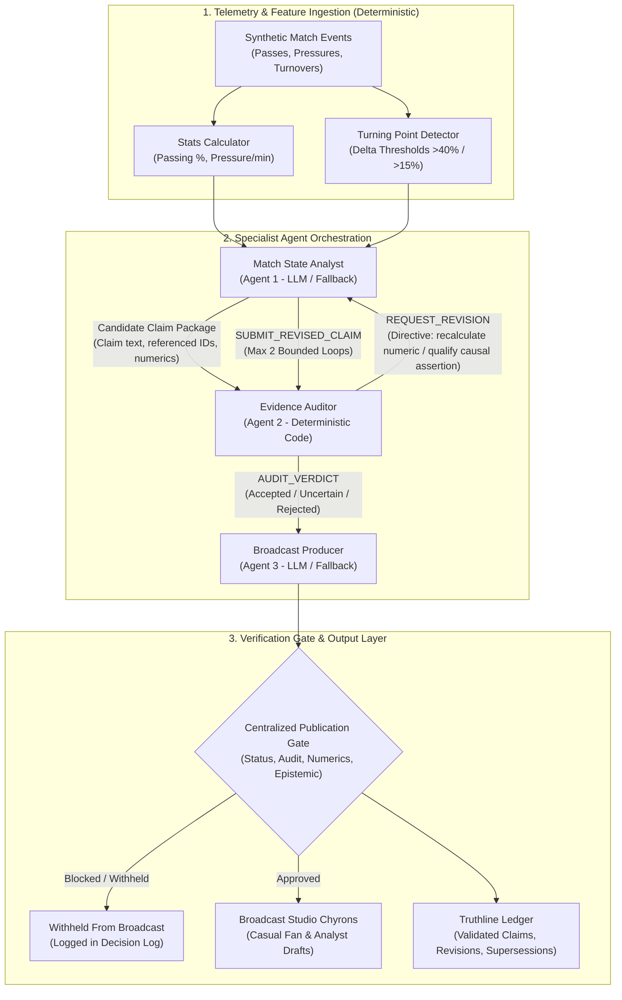
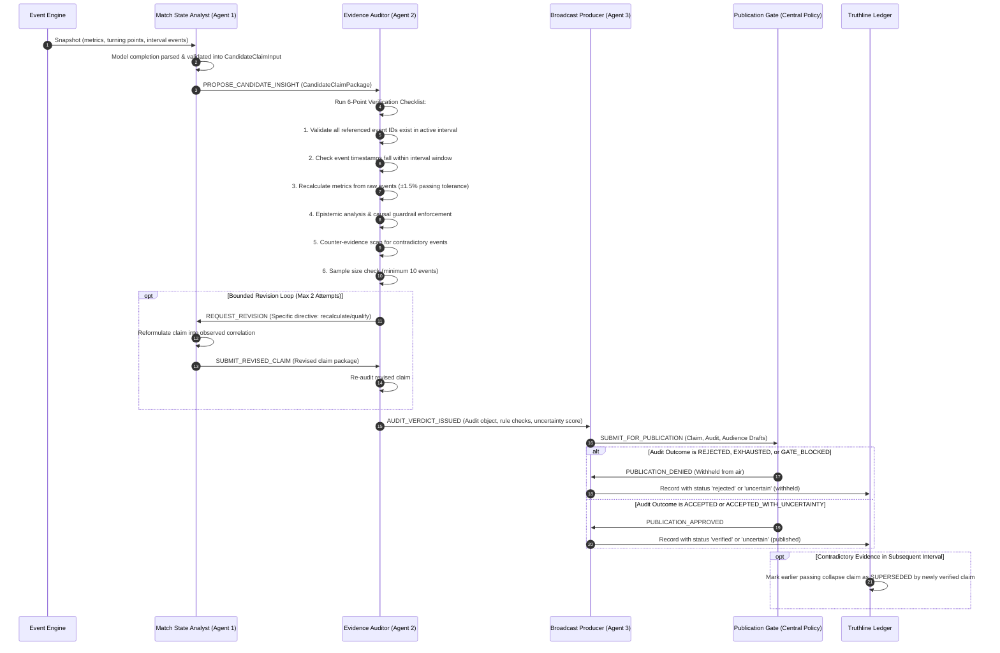
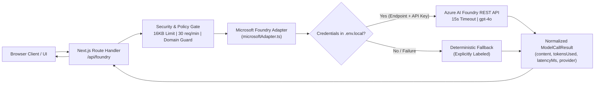

# Proofline FC — System Architecture & Verification Mechanics

## Executive Summary

Proofline FC is an evidence-gated multi-agent platform designed to produce factual, explainable tactical insights from football telemetry. Its central architectural guarantee is that **no language model output may bypass deterministic verification**.

---

## 1. Core Architecture & Component Boundaries

The platform is organized into three distinct layers:
1. **Telemetry & Feature Ingestion Layer**: Ingests raw match events, computes rolling spatial statistics, and detects statistical threshold crossings (turning points).
2. **Specialist Multi-Agent Orchestration Layer**: Coordinates proposal, audit, bounded revision, and broadcast packaging.
3. **Evidence Verification & Ledger Layer**: Runs the deterministic 6-point mathematical verification engine (`verifier.ts`), enforces the centralized publication policy gate (`publicationGate.ts`), maintains the Truthline ledger, and gates on-air broadcast displays.



---

## 2. Model vs. Deterministic Boundaries

To guarantee technical credibility, model-based reasoning is strictly bounded:

| Component | Execution Type | Model Role | Deterministic Fallback / Gate |
| :--- | :---: | :--- | :--- |
| **Event Generator** | Deterministic | None | Pseudorandom seed-based synthetic generator (`generator.ts`). |
| **Stats Calculator** | Deterministic | None | Exact mathematical recalculations; guarded against division-by-zero. |
| **Match State Analyst** | Hybrid (LLM + Fallback) | Drafts candidate claims via live Azure AI Foundry structured JSON; validated strictly against schema. | If Foundry credentials missing or inference fails: Uses deterministic fallback templates. Only labeled as live when model output influences candidate. |
| **Evidence Auditor** | **100% Deterministic** | **None** | Completely independent code verifier. Never delegates audit decisions to an LLM. |
| **Epistemic Guardrails** | Deterministic | None | Regex and vocabulary parser detecting causal words (`caused`, `forced`, `led to`). |
| **Broadcast Producer** | Hybrid (LLM + Fallback) | Adapts verified facts into audience-specific drafts (Casual Fan vs Analyst). | Centralized Publication Gate (`publicationGate.ts`): Server-side policy boundary strictly blocking unverified claims, fabricated numbers, or invented tactical mechanisms. |
| **Truthline Ledger** | Deterministic | None | Stateful claim ledger; handles deduplication and validated supersession links. |

---

## 3. Detailed Multi-Agent Sequence & Hand-offs



---

## 4. The 6-Point Deterministic Evidence Checklist

Implemented in `src/lib/verificationEngine/verifier.ts` and `rules.ts`:

1. **Event Reference Verification** (`referencedEventsExist`): Every referenced event ID (e.g., `ev_sig_0012`) must exist in the active event stream and belong to the active match interval.
2. **Interval Boundary Alignment** (`intervalBoundariesValid`): Referenced events must have timestamps (`minute`, `second`) falling strictly within the requested interval window (e.g., `16'-30'`). Cross-interval contamination is rejected.
3. **Independent Recalculation & Tolerance** (`numericClaimsVerified`): Claimed metric percentages (e.g., passing accuracy) are recalculated from underlying raw events via `calculateTeamIntervalMetrics`. Recalculations must match within strict tolerances (±1.5% for passing accuracy, ±0.2/min for pressure frequency, ±1.0 for counts). Unknown metrics and empty assertion lists fail closed.
4. **Epistemic Classification & Causal Guardrail** (`causalGuardrailPassed`): Flags unproven causal attribution verbs (`caused`, `led to`, `forced`) without verifiable mechanism evidence and downgrades claims to `accepted_with_uncertainty` (observed correlation).
5. **Counter-Evidence Assessment** (`counterEvidenceAssessed`): Scans raw events for contradictory events (e.g., successful progressive passes during an alleged collapse).
6. **Sample Size Threshold** (`sampleSizeSufficient`): The interval must contain at least 10 recorded events. If count $< 10$, the claim is marked `insufficient_evidence` with calibrated high uncertainty ($\ge 0.85$).

### The Centralized Publication Gate (`publicationGate.ts`)

Before any claim can be published to on-air graphics:
- **Status Check**: Status must be `verified` or qualified `uncertain`. Claims with status `rejected`, `proposed`, or `superseded` are blocked.
- **Audit Verification**: Validates that the claim's audit actually passed. Forged `verified` claims with missing audit checks are blocked.
- **Interval Consistency**: Verifies the claim belongs to the active match interval.
- **Evidence Integrity**: All supporting event IDs must be valid.
- **Draft Numeric Veracity**: Producer audience drafts are parsed for numeric statements; numbers must match verified metric assertions.
- **Broadcast Guardrails**: Paraphrased broadcast drafts are scanned for causal trigger words and invented tactical mechanisms (`in their own half`, `bypassed pressing traps`).

---

## 5. Truthline Ledger & Contradiction Supersession

The Truthline ledger maintains a stateful audit history across intervals:

```
[Interval 01'-15'] clm_baseline_01  ──► VERIFIED   (Balanced tactical baseline)
[Interval 16'-30'] clm_collapse_16  ──► SUPERSEDED (Passing collapsed to ~58% under press)
                                              │
                                              ▼ (Superseded by newly verified claim)
[Interval 31'-45'] clm_rebound_31   ──► VERIFIED   (Passing rebounded to 75%+ under press)
```

When new match evidence invalidates an earlier thesis:
- The earlier record's `status` transitions from `verified` to `superseded`.
- `supersededByClaimId` records the ID of the newly verified insight.
- `supersessionReason` provides an explicit explanation of why the earlier claim no longer holds.
- Supersession is gated on genuine verification: an unverified or rejected candidate cannot supersede a verified claim.
- The on-air chyron updates immediately to reflect tactical adaptation rather than repeating obsolete commentary.

---

## 6. Microsoft Foundry Integration Architecture

The platform supports live Azure AI Foundry model execution alongside deterministic local fallback:



### Server-Side Safeguards:
- **16KB Body Limit**: Prevents payload inflation attacks (HTTP 413).
- **In-Memory Rate Limiting**: 30 requests per minute per IP window (HTTP 429).
- **Football Domain Filter**: Validates prompt topic to prevent open proxy abuse (HTTP 400).
- **15-Second Timeout**: `AbortSignal.timeout(15000)` prevents thread blocking on hanging upstream connections (HTTP 504).
- **Safe Error Responses**: Upstream errors returned cleanly without exposing provider secrets or stack traces (HTTP 502/503).
